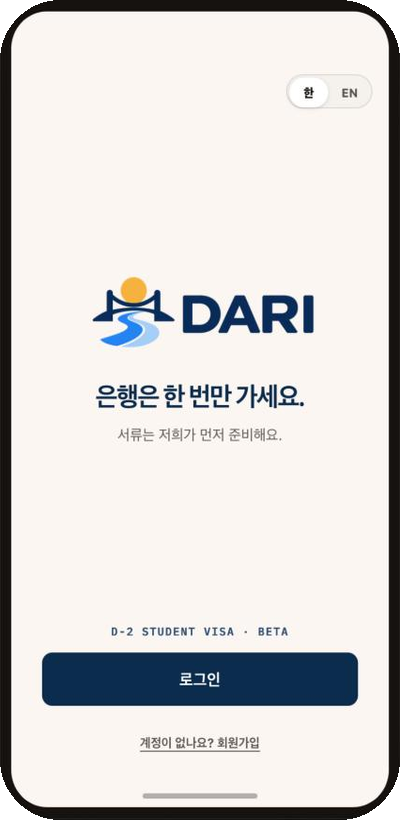
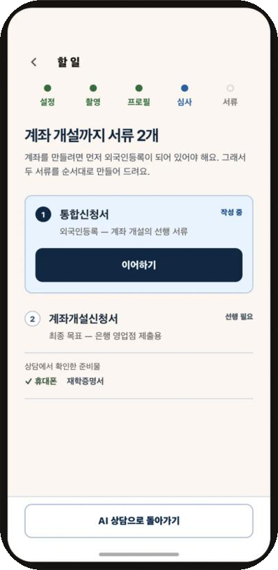

<div align="center">


### 은행은 한 번만 가세요. 서류는 저희가 먼저 준비해요.

국내 체류 외국인의 금융·행정 정착을 돕는 AI 에이전트

<!-- TODO: 실제 배포 주소 -->
[**데모 바로가기 →**](https://YOUR-DEMO-URL)

</div>

> [!NOTE]
> DARI의 결과는 출입국·금융기관의 판단을 대신하지 않습니다. 되돌릴 수 없는 행동은 반드시 사용자 승인을 거치며, 법적으로 위임할 수 없는 행동(예: 금융실명법 제3조 본인확인)은 안내만 제공합니다.

**목차** · [프로젝트 소개](#프로젝트-소개) · [작동 방법](#작동-방법) · [실행 방법](#실행-방법) · [팀원](#팀원) · [문서](#문서)

<br/>

## 프로젝트 소개

신분증을 찍어 올리면 OCR 로 프로필을 만들고, 체류자격 룰로 **지금 무엇을 할 수 있고
무엇이 막혀 있는지**를 계산해 과제 목록으로 보여준다. 법령·안내매뉴얼을 검색해 근거와 함께
답하고, 통합신청서 같은 서식을 채워 PDF 로 만들어 준다. 되돌릴 수 없는 행동에는 승인 게이트가 걸린다.

```
외국인등록증·여권 촬영 → 프로필 확인 → 체류자격 판정 → 과제 그래프
                                              ↓
                            질의응답(법령·매뉴얼 RAG) · 서류 생성 → 승인 → 보관함
```

<br/>

## 작동 방법

| 설정 | 촬영 | 프로필 | 심사 | 서류 |
|:---:|:---:|:---:|:---:|:---:|
|  |  |  |  |  |
| 언어 · 체류자격 선택 | 신분증 3장 촬영 | 인식 정보 확인 | AI 상담 · 할 일 | 신청서 발급 |

<br/>

## 실행 방법

### 전체 스택 (Docker)

```bash
cp ai/.env.example .env.local
```

값을 채운 뒤(`ANTHROPIC_API_KEY`, `CLOVA_*` 등):

```bash
docker compose -f compose.local.yml up -d --build
```

- 앱 http://localhost:8081
- Swagger http://localhost:8081/swagger-ui.html
- 헬스체크 http://localhost:8081/health/ai · http://localhost:8081/health/backend

### 개별 실행 (개발)

```bash
docker compose up -d db
```

```bash
cd ai && cp .env.example .env && uv sync && uv run uvicorn app.main:app --reload --port 8000
```

```bash
cd backend/server && cp .env.example .env && ./gradlew bootRun
```

```bash
cd frontend/frontend-react && npm install && npm run dev
```

API 스펙: AI http://localhost:8000/docs · Backend http://localhost:8080/swagger-ui.html

`JWT_SECRET`은 32바이트 이상이어야 합니다. 백엔드 없이 화면만 볼 때는 `VITE_USE_MOCK=true npm run dev`로 목데이터를 씁니다.

<br/>

## 팀원

<!-- TODO: 실제 팀원 정보로 교체 -->
|  |  |  |  |
|:---:|:---:|:---:|:---:|
| [@USER1](https://github.com/USER1) | [@USER2](https://github.com/USER2) | [@USER3](https://github.com/USER3) | [@USER4](https://github.com/USER4) |
| 역할 | 역할 | 역할 | 역할 |

<br/>

## 문서

| 문서 | 내용 |
|---|---|
| [서비스 기능](docs/features.md) | 문제와 해결 · 화면별 기능 |
| [기술 스택과 아키텍처](docs/architecture.md) | 사용 기술 · 서비스 구조 · 포트 |
| [에이전트 설계](docs/agent.md) | 상태 기계 · 위험 등급 · 룰 · 선행조건과 완료 |
| [검색과 근거 자료](docs/rag.md) | RAG 코퍼스 · 하이브리드 검색 · 자료 최신성 |
| [서류 생성과 개인정보](docs/documents-and-privacy.md) | PDF 렌더 · 데이터 보관과 삭제 |
| [API](docs/api.md) | AI · Backend 주요 엔드포인트 |
| [개발 가이드](docs/development.md) | 환경 변수 · 테스트 · 디렉터리 구조 |
| [배포 · CI/CD](docs/deployment.md) | CI · CD · 롤백 · 인프라 |
