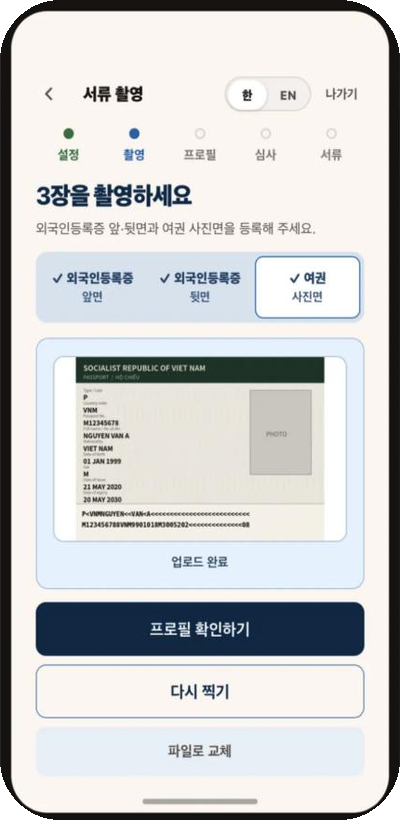
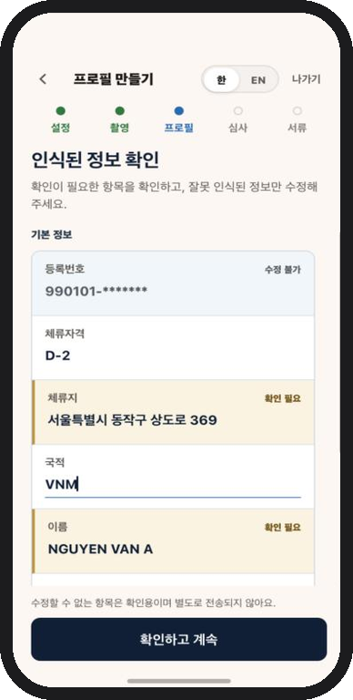
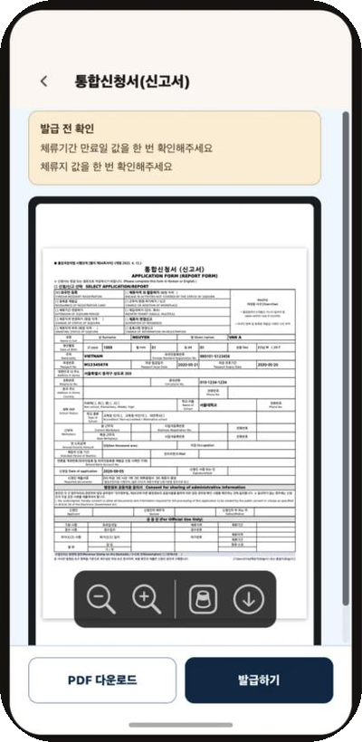
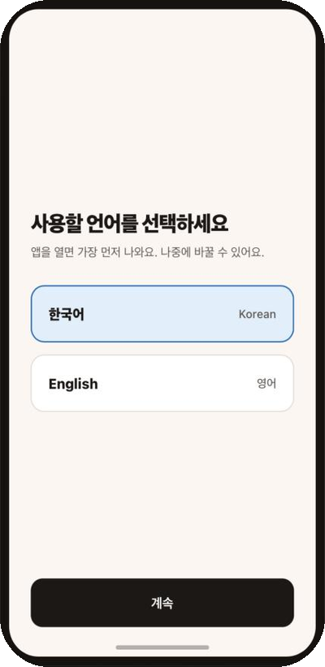
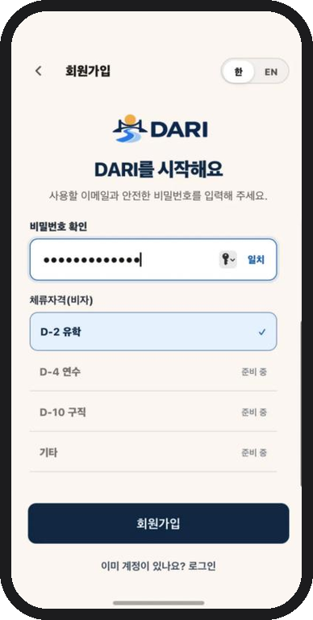
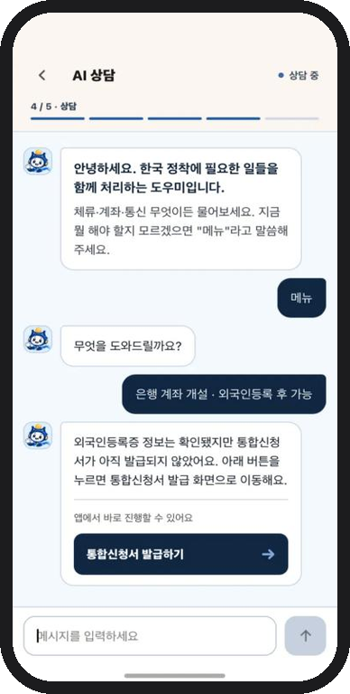
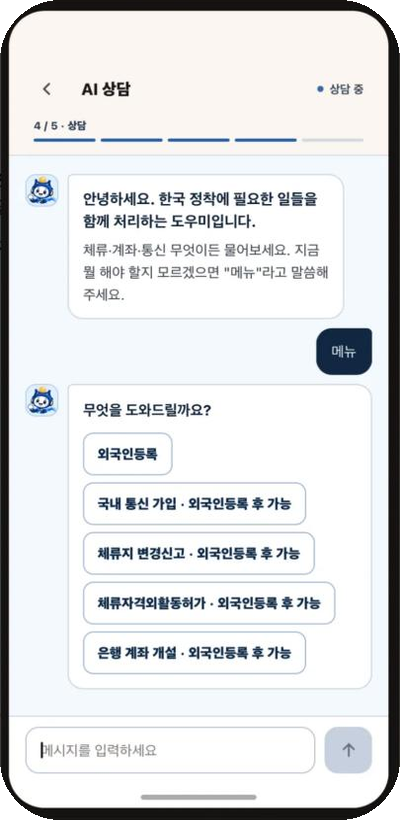
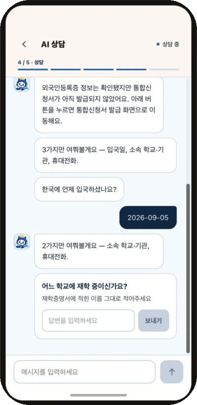
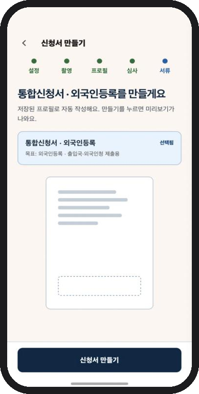
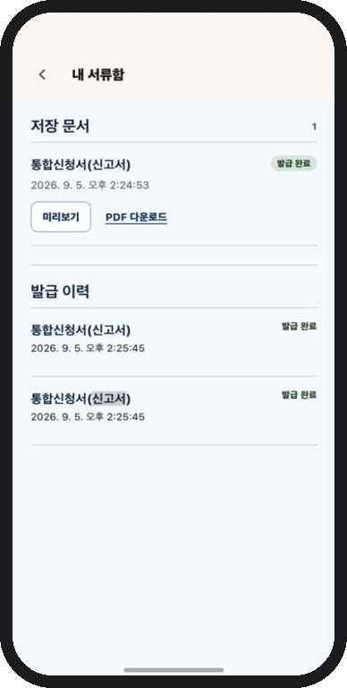

<div align="center">


<br/>

### 은행은 한 번만 가세요. 서류는 저희가 먼저 준비해요.

**한국어를 몰라도, 순서를 몰라도 - 신분증 사진 몇 장이면 됩니다.**

국내 체류 외국인이 외국인등록부터 계좌 개설까지, 지금 할 수 있는 일과 먼저 할 일을 확인하고<br/>
필요한 신청서를 받아 가는 금융·행정 정착 AI 에이전트

<br/>

<!-- TODO: 실제 배포 주소 -->
[](https://YOUR-DEMO-URL)


</div>

<br/>

> 판단은 기관이 합니다. DARI는 그 앞의 준비를 합니다.<br/>
> 되돌릴 수 없는 일은, 반드시 사용자가 승인한 뒤에만 합니다.

<br/>

## 목차

| 서비스 | 기술 | 실행 · 참고 |
|---|---|---|
| [프로젝트 소개](#프로젝트-소개) | [기술 스택](#기술-스택) | [실행 방법](#실행-방법) |
| [한눈에 보기](#한눈에-보기) | [아키텍처](#아키텍처) | [API](#api) |
| [주요 기능](#주요-기능) | [서류 생성과 개인정보](#서류-생성과-개인정보) | [팀원](#팀원) · [문서](#문서) |

<br/>

## 프로젝트 소개

신분증을 찍어 올리면 OCR 로 프로필을 만들고, 체류자격 룰로 **지금 무엇을 할 수 있고
무엇이 막혀 있는지**를 계산해 과제 목록으로 보여준다. 법령·안내매뉴얼을 검색해 근거와 함께
답하고, 통합신청서 같은 서식을 채워 PDF 로 만들어 준다. 되돌릴 수 없는 행동에는 승인 게이트가 걸린다.

```
외국인등록증·여권 촬영 → 프로필 확인 → 체류자격 판정 → 과제 그래프
                                              ↓
                            질의응답(법령·매뉴얼 RAG) · 서류 생성 → 승인 → 보관함
```

### 문제

정착 초기의 행정 절차는 서로 물려 있습니다. 외국인등록을 마쳐야 다음 절차가 열리고, 체류자격마다 필요한 서류와 제출처가 다릅니다.

```
외국인등록 (입국 후 90일 이내)
  ├─ 휴대폰 개통 → 비대면 계좌 개설
  └─ 계좌 개설(방문) · 체류지 변경신고 · 시간제취업 허가
```

### 해결

| | DARI가 하는 일 |
|:---:|---|
| **순서** | 체류자격 규칙으로 지금 할 수 있는 일과 먼저 할 일을 판정 |
| **근거** | 법령 · 법무부 매뉴얼에서 찾아 출처와 함께 답변 |
| **서류** | 신분증에서 읽은 값으로 신청서 자동 작성, 빈칸만 질문 |

<br/>

## 한눈에 보기

| 설정 | 촬영 | 프로필 | 심사 | 서류 |
|:---:|:---:|:---:|:---:|:---:|
|  |  |  |  |  |
| 언어 · 체류자격 선택 | 신분증 3장 촬영 | 인식 정보 확인 | AI 상담 · 할 일 | 신청서 발급 |

<br/>

## 주요 기능

### ① 설정 - 언어 · 체류자격 선택

| 언어 선택 | 시작 화면 | 회원가입 · 체류자격 |
|:---:|:---:|:---:|
|  |  |  |
| 앱을 열면 가장 먼저 언어를 고릅니다. 상단 `한 / EN` 토글로 언제든 바꿀 수 있습니다. | 현재 베타는 **D-2 유학** 비자 대상입니다. | 가입 시 고른 체류자격의 규칙표(`visa_matrix.yaml`)로 이후 판정이 이뤄집니다. D-4·D-10은 준비 중입니다. |

### ② 촬영 · ③ 프로필 - OCR과 인식 정보 확인

| 서류 촬영 | 인식 정보 확인 |
|:---:|:---:|
|  |  |
| 외국인등록증 앞·뒷면과 여권 사진면 **3장**을 찍으면 CLOVA OCR로 읽고, 여권은 **MRZ 교차검증**으로 오인식을 줄입니다. 원본 사진은 OCR 직후 삭제됩니다. | 신뢰도 0.95 미만 필드는 `확인 필요`로 표시되어 그 값만 고치면 됩니다. 등록번호는 `990101-*******`로 마스킹되고 수정할 수 없습니다. |

### ④ 심사 - AI 상담과 할 일 판정

| 처음 안내 | 메뉴 | 빈칸만 질문 | 할 일 |
|:---:|:---:|:---:|:---:|
|  |  |  |  |
| "계좌 개설"을 눌러도 외국인등록 전이면 **선행 서류(통합신청서)로 안내**합니다. | 할 일마다 `외국인등록 후 가능` 같은 **선행조건**이 함께 표시됩니다. | 프로필로 못 채운 값만 **한 번에 하나씩** 묻습니다. | 계좌 개설까지 필요한 서류 2개를 **순서대로** 보여 줍니다. |

- 이미 외국인등록번호가 있으면 등록을 마친 것으로 보고 다음 단계가 바로 열립니다.
- 질문에는 **법령 397개 조문**과 법무부 「외국인체류 안내매뉴얼」 **1,212개 청크**에서 찾아 근거와 함께 답합니다.

### ⑤ 서류 - 신청서 생성 · 승인 · 보관

| 신청서 만들기 | 미리보기 · 발급 | 내 서류함 |
|:---:|:---:|:---:|
|  |  |  |
| 저장된 프로필로 통합신청서(신고서)를 **자동 작성**합니다. 서류 생성에는 LLM을 쓰지 않습니다. | 발급 전 확인할 값을 위에 띄우고, 사용자가 **발급하기**를 눌러야만 저장됩니다. | 발급한 문서와 이력이 남아 언제든 미리보기·PDF 다운로드할 수 있습니다. |

<br/>

## 기술 스택

**Frontend**


**Backend**


**AI**


**Infra**


<br/>

## 아키텍처

```
                     ┌───────────────┐
브라우저 ──────────► │ Caddy (:8081) │  경로 라우팅
                     └───────┬───────┘
                  ┌──────────┼──────────┐
                  ▼          ▼          ▼
            frontend      backend    /health/*
          React + Vite  Spring Boot
            (nginx)     Java 21 · :8080
                            │  RestClient
                            ▼
                      ai · FastAPI + LangGraph · :8000
                            │
                            ▼
                      PostgreSQL + pgvector
```

| 서비스 | 스택 | 역할 | 포트 |
|---|---|---|---|
| `frontend/` | React 18 · Vite 5 · React Router | 모바일 프레임 단일 페이지. 촬영 → 확인 → 과제 → 서류 흐름 | 5173 (dev) / 3000 (nginx) |
| `backend/` | Java 21 · Spring Boot 3 · JPA | 회원·JWT 인증, S3 presigned 업로드, 생성 서류 영속화, AI 서비스 중계 | 8080 |
| `ai/` | Python 3.12 · FastAPI · LangGraph | 에이전트 상태 기계, OCR 추출, 룰 엔진, RAG 질의응답, 서식 렌더 | 8000 |
| `db` | pgvector/pgvector:pg16 | 회원·서류 테이블, LangGraph 체크포인트, `rag.chunk` 벡터 | 5432 |
| `deploy/` | Caddy 2 | 리버스 프록시 (`/api/*` → backend, 그 외 → frontend) | 8081 |
| `mock-institution/` | Python | 기관 API 시뮬레이터 (스켈레톤) | - |

프론트는 개발 시 Vite 프록시로 `/api/v1/*`를 Spring에, 나머지 `/api/*`를 AI에 직접 보냅니다. 운영에서는 Caddy가 `/api/*`를 전부 backend로 보내고 backend가 AI를 중계합니다.

### 에이전트

```
planner → router ─┬─ explainer     질문에 근거와 함께 답변
                  ├─ slot_filler   빈 항목만 하나씩 질문
                  └─ doc_builder → approval_gate → executor → replanner
```

- 흐름은 그래프(`ai/app/agent/graph.py`)가 정하고, LLM은 도구를 고르지 않습니다.
- `approval_gate`를 건너뛰는 경로가 없어, 서류 발급 같은 행동은 사용자 승인 없이 실행되지 않습니다.
- 행동은 위험도로 나뉩니다. **L1** 자동 통과 · **L2** 사용자 승인 후 실행 · **L3** 법적으로 위임 불가 → 안내만.

<details>
<summary><b>규칙 파일</b></summary>

| 파일 | 내용 |
|---|---|
| `ai/rules/visa_matrix.yaml` | 체류자격별 허용 행동·선행조건·기한·필요서류·제출처·위험도 |
| `ai/rules/visa_codes.yaml` | D-2, D-4, D-8, D-10, E-7, E-9, F-2, F-4, F-5, F-6, H-2 |
| `ai/rules/evidence.yaml` | 답변에 인용하는 법령 조문 |
| `ai/mappings/*.yaml` | 통합신청서·계좌개설 신청서 필드 매핑 |

완료 판단은 두 가지로 나뉩니다. `prereq_satisfied`는 현실에서 이미 끝난 단계(예: 외국인등록번호 보유)로 다음 작업을 열고, `completed`는 앱에서 서류를 만들고 승인까지 받은 작업입니다. 이미 등록한 사용자가 통합신청서부터 다시 만들 필요가 없도록 분리했습니다.

</details>

### 법령 · 매뉴얼 검색

- **코퍼스**: 출입국관리법·시행령, 금융실명법, 특정금융정보법 397개 조문 + 「외국인체류 안내매뉴얼」(법무부, 2026. 8.) 1,212개 청크
- **검색**: 한글 음절 bigram BM25와 pgvector 코사인 유사도를 RRF로 합칩니다. 사용자 체류자격에 맞는 청크는 ×1.6, 다른 자격 전용 청크는 ×0.45.
- **질의 변환**: 영어 질문은 문서 용어로 바꿔 검색합니다 (`part-time job` → `시간제취업 체류자격 외 활동`).
- **출처 관리**: `.github/workflows/check-sources.yml`이 매일 출처 판본과 확인일을 점검하고, 오래되면 이슈를 엽니다.

<br/>

## 서류 생성과 개인정보

```
profile + mappings/*.yaml → Jinja2 템플릿 → WeasyPrint → PDF
```

| 데이터 | 저장 위치 | 보존 |
|---|---|---|
| 신분증 사진 | S3 `members/{id}/uploads/` | **OCR 직후 삭제** |
| OCR 원문 텍스트 | - | **저장하지 않음** |
| 프로필 · 대화 | Postgres checkpointer | 마지막 활동 기준 30일 |
| 생성된 PDF | S3 `members/{id}/generated-documents/` | 회원 문서로 보관 |

- 외국인등록번호는 응답에서 `990101-*******`로 마스킹합니다. PDF 렌더링에만 원본을 씁니다.
- 예외 메시지는 클라이언트로 보내지 않고 예외 타입만 전달합니다.

<br/>

## 실행 방법

### 전체 스택 (Docker)

```bash
cp ai/.env.example .env.local
```

값을 채운 뒤(`ANTHROPIC_API_KEY`, `CLOVA_*` 등):

```bash
docker compose -f compose.local.yml up -d --build
```

- 앱 http://localhost:8081
- Swagger http://localhost:8081/swagger-ui.html
- 헬스체크 http://localhost:8081/health/ai · http://localhost:8081/health/backend

### 개별 실행 (개발)

```bash
docker compose up -d db
```

```bash
cd ai && cp .env.example .env && uv sync && uv run uvicorn app.main:app --reload --port 8000
```

```bash
cd backend/server && cp .env.example .env && ./gradlew bootRun
```

```bash
cd frontend/frontend-react && npm install && npm run dev
```

API 스펙: AI http://localhost:8000/docs · Backend http://localhost:8080/swagger-ui.html

`JWT_SECRET`은 32바이트 이상이어야 합니다. 백엔드 없이 화면만 볼 때는 `VITE_USE_MOCK=true npm run dev`로 목데이터를 씁니다.

<br/>

## API

| Method | Path | 설명 |
|:---:|---|---|
| `POST` | `/api/v1/auth/signup` · `/login` | 회원가입 · JWT 발급 |
| `POST` | `/api/v1/uploads` | S3 presigned PUT URL 발급 |
| `POST` | `/api/v1/documents/extractions` | `uploadId`로 OCR 요청 |
| `POST` | `/api/session` | 세션 생성 · 재개 · 초기화 |
| `POST` | `/api/profile/confirm` | 확인 화면 수정값 반영 |
| `POST` | `/api/chat` · `/api/chat/stream` | 대화 (stream은 SSE) |
| `POST` | `/api/actions/{id}/start` · `/preview` · `/approve` | 서류 작성 시작 · 미리보기 · 승인 |
| `GET` | `/api/state` · `/api/ledger` | 상태 복원 · 처리 이력 |
| `GET` | `/api/documents/{id}/preview` · `/download` | 생성 문서 미리보기 · 다운로드 |

에이전트 응답은 `{ schema_version, reply, ui, state }` 형식입니다. 자세한 내용은 [docs/api.md](docs/api.md)를 참고하세요.

<br/>

## 팀원

|  |  |  |  |
|:---:|:---:|:---:|:---:|
| 팀장 · AI | AI | Backend · Frontend | Cloud |
| [@HojuneLee0106](https://github.com/HojuneLee0106) | [@rlaekdus75](https://github.com/rlaekdus75) | [@JoonseobKim](https://github.com/JoonseobKim) | [@zikpoka5-commits](https://github.com/zikpoka5-commits) |

<br/>

## 문서

| 문서 | 내용 |
|---|---|
| [에이전트 설계](docs/agent.md) | 상태 기계 · 위험 등급 · 룰 · 선행조건과 완료 |
| [검색과 근거 자료](docs/rag.md) | RAG 코퍼스 · 하이브리드 검색 · 자료 최신성 |
| [서류 생성과 개인정보](docs/documents-and-privacy.md) | PDF 렌더 · 데이터 보관과 삭제 |
| [API](docs/api.md) | AI · Backend 주요 엔드포인트 |
| [개발 가이드](docs/development.md) | 환경 변수 · 테스트 · 디렉터리 구조 |
| [배포 · CI/CD](docs/deployment.md) | CI · CD · 롤백 · 인프라 |
