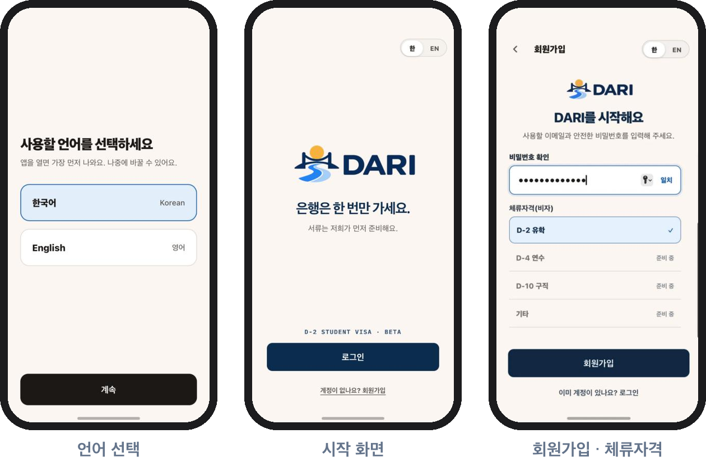
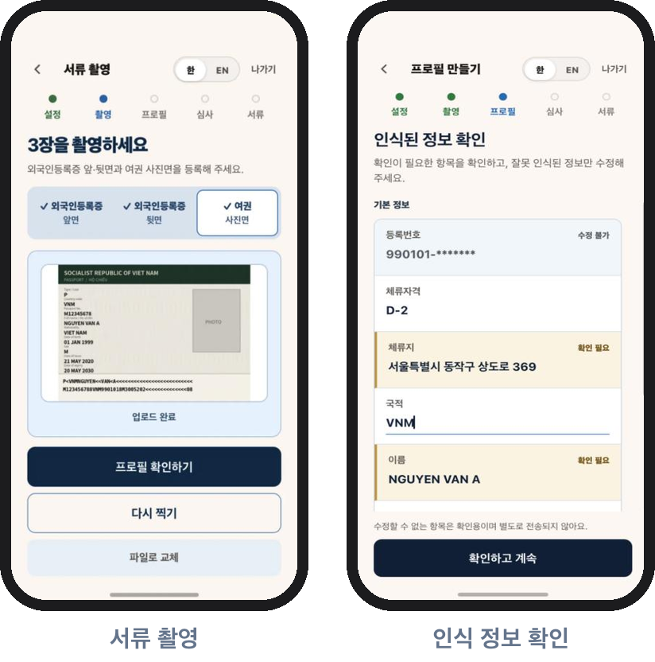
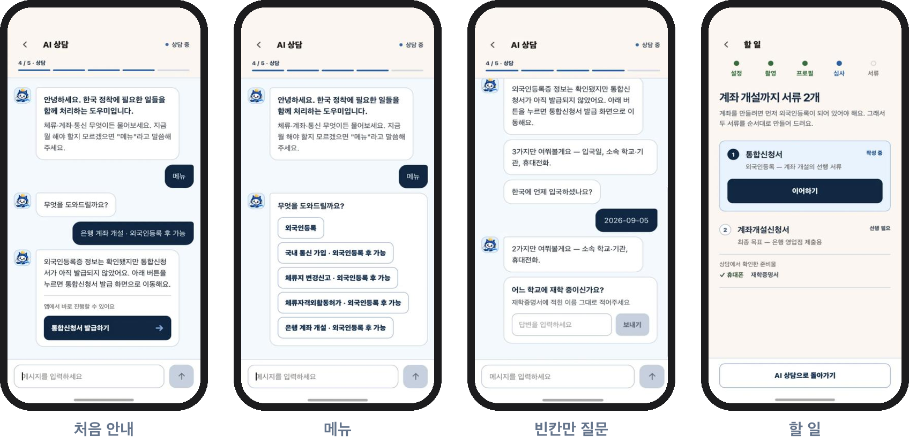
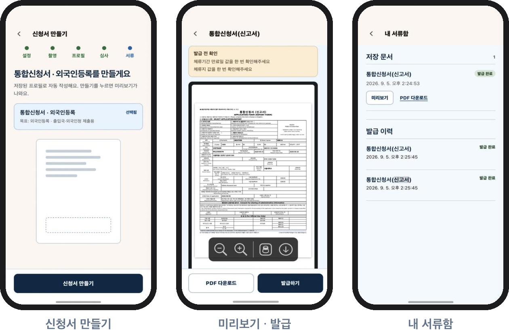

# 서비스 기능

> 화면별 기능 상세. 요약은 [README](../README.md)를 참고하세요.

## 서비스 개요

### 문제

정착 초기의 행정 절차는 서로 물려 있습니다. 외국인등록을 마쳐야 다음 절차가 열리고, 체류자격마다 필요한 서류와 제출처가 다릅니다.

```
외국인등록 (입국 후 90일 이내)
  ├─ 휴대폰 개통 → 비대면 계좌 개설
  └─ 계좌 개설(방문) · 체류지 변경신고 · 시간제취업 허가
```

### 해결

| | DARI가 하는 일 |
|:---:|---|
| **순서** | 체류자격 규칙으로 지금 할 수 있는 일과 먼저 할 일을 판정 |
| **근거** | 법령 · 법무부 매뉴얼에서 찾아 출처와 함께 답변 |
| **서류** | 신분증에서 읽은 값으로 신청서 자동 작성, 빈칸만 질문 |


## 화면별 기능

### ① 설정 - 언어 · 체류자격 선택

<p align="center"></p>

- **언어 선택** - 앱을 열면 가장 먼저 언어를 고릅니다. 상단 `한 / EN` 토글로 언제든 바꿀 수 있습니다.
- **시작 화면** - 현재 베타는 **D-2 유학** 비자 대상입니다.
- **회원가입 · 체류자격** - 가입 시 고른 체류자격의 규칙표(`visa_matrix.yaml`)로 이후 판정이 이뤄집니다. D-4·D-10은 준비 중입니다.

### ② 촬영 · ③ 프로필 - OCR과 인식 정보 확인

<p align="center"></p>

- **서류 촬영** - 외국인등록증 앞·뒷면과 여권 사진면 **3장**을 찍으면 CLOVA OCR로 읽고, 여권은 **MRZ 교차검증**으로 오인식을 줄입니다. 원본 사진은 OCR 직후 삭제됩니다.
- **인식 정보 확인** - 신뢰도 0.95 미만 필드는 `확인 필요`로 표시되어 그 값만 고치면 됩니다. 등록번호는 `990101-*******`로 마스킹되고 수정할 수 없습니다.

### ④ 심사 - AI 상담과 할 일 판정

<p align="center"></p>

- **처음 안내** - "계좌 개설"을 눌러도 외국인등록 전이면 **선행 서류(통합신청서)로 안내**합니다.
- **메뉴** - 할 일마다 `외국인등록 후 가능` 같은 **선행조건**이 함께 표시됩니다.
- **빈칸만 질문** - 프로필로 못 채운 값만 **한 번에 하나씩** 묻습니다.
- **할 일** - 계좌 개설까지 필요한 서류 2개를 **순서대로** 보여 줍니다.

이미 외국인등록번호가 있으면 등록을 마친 것으로 보고 다음 단계가 바로 열립니다. 질문에는 **법령 397개 조문**과 법무부 「외국인체류 안내매뉴얼」 **1,212개 청크**에서 찾아 근거와 함께 답합니다.

### ⑤ 서류 - 신청서 생성 · 승인 · 보관

<p align="center"></p>

- **신청서 만들기** - 저장된 프로필로 통합신청서(신고서)를 **자동 작성**합니다. 서류 생성에는 LLM을 쓰지 않습니다.
- **미리보기 · 발급** - 발급 전 확인할 값을 위에 띄우고, 사용자가 **발급하기**를 눌러야만 저장됩니다.
- **내 서류함** - 발급한 문서와 이력이 남아 언제든 미리보기·PDF 다운로드할 수 있습니다.
